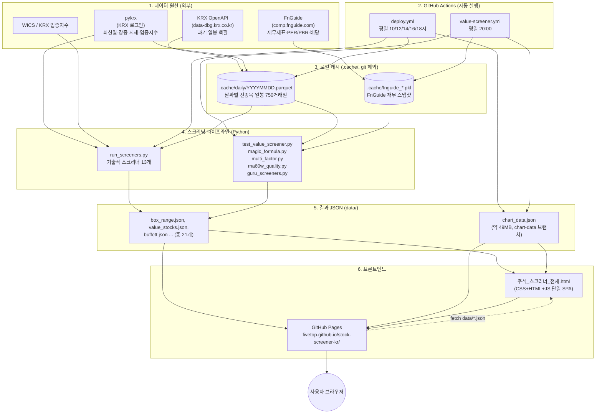
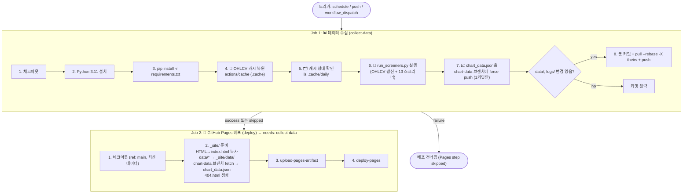
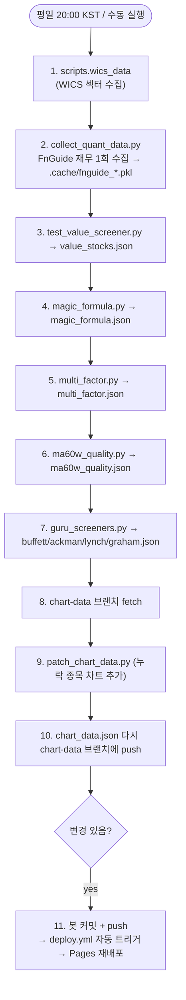
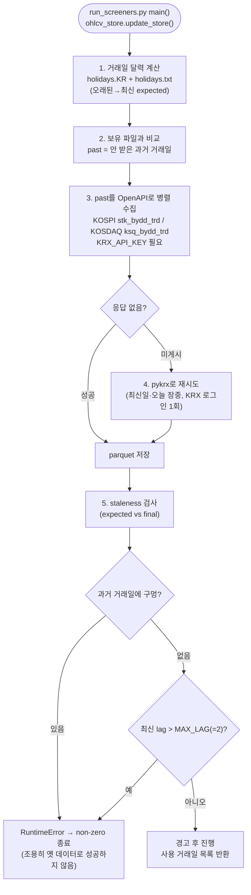
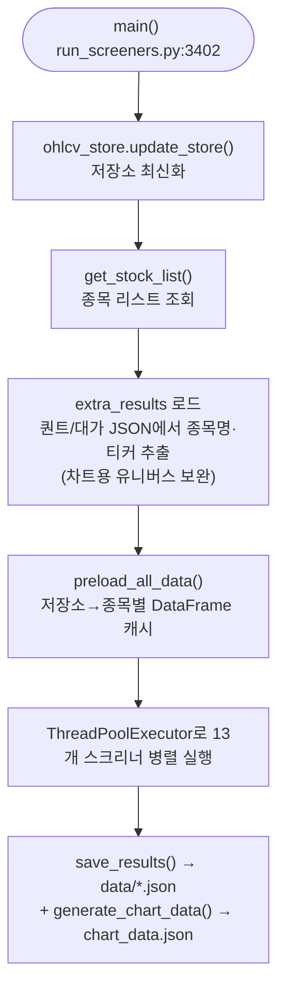
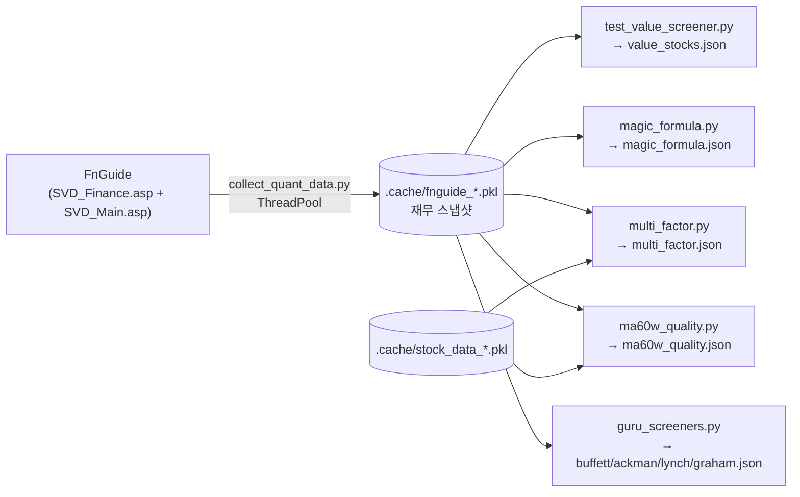
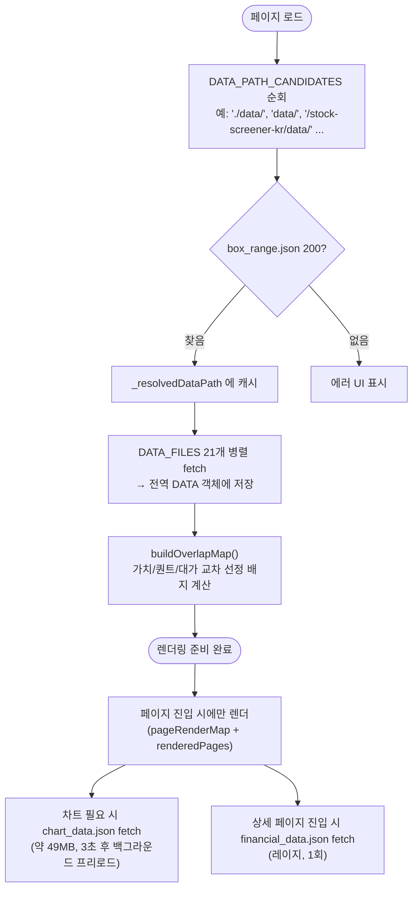

# 국내 주식 종목 발굴 스크리너

기술적 분석 기반 국내 주식 스크리닝 도구입니다.
GitHub Actions와 GitHub Pages를 이용해 100% 무료로 운영됩니다.

**[사이트 바로가기](https://fivetop.github.io/stock-screener-kr/)**

## 스크리너 목록

### 박스권 패턴
| 스크리너 | 설명 |
|----------|------|
| **박스권 횡보** | 60거래일 이상 횡보 중인 종목 (변동폭 25% 이내) |
| **박스권 돌파 (거래량)** | 저항선 돌파 + 거래량 2배 + 150일선 위 |
| **박스권 돌파 (단순)** | 저항선 돌파 후 10일 이내 |
| **풀백** | 돌파 후 저항선으로 되돌림 (거래량 50% 감소) |

### 거래량 분석
| 스크리너 | 설명 |
|----------|------|
| **거래량 폭발** | 40일 평균 대비 6배 거래량 + 6% 이상 상승 |
| **거래량 급감** | 8% 급등 후 거래량 50% 이상 감소 (세력 보유 신호) |

### 추세 및 신고가
| 스크리너 | 설명 |
|----------|------|
| **52주 신고가** | 신고가 돌파 후 8거래일 이내 |
| **이평선 수렴** | 이동평균선 수렴 + 정배열 + 신고가 |

### 반등 및 저점매수
| 스크리너 | 설명 |
|----------|------|
| **바닥 탈출** | 150일선 근접 + 저점 상승 + MACD 신호 (점수제) |
| **낙폭과대 반등** | 52주 고가 대비 -40% + 바닥 상승 전환 |

### 가치 및 우량주
| 스크리너 | 설명 |
|----------|------|
| **저평가 우량주** | PER/PBR + 매출/영업이익/EPS 성장률 기반 (FnGuide TTM) |
| **60주선 우량주** | 60주선 지지 + 영업이익률 10%↑ + 성장률 10%↑ |

### 업종 분석
| 스크리너 | 설명 |
|----------|------|
| **업종별 4단계** | 섹터 로테이션 기반 업종 추세 분석 |

## 자동 업데이트 스케줄

| 스크리너 | 실행 시간 (KST) |
|----------|----------------|
| 기술적 스크리너 (박스권, 거래량 등) | 매일 12:00, 14:00, 16:00, 18:00 |
| 저평가 우량주 (TTM) | 매주 토요일 12:00 |

## 로컬 실행

### 1. 환경 설정

```bash
# 저장소 클론
git clone https://github.com/hsh2578/stock-screener-kr.git
cd stock-screener-kr

# 가상환경 생성 및 활성화
python -m venv venv
venv\Scripts\activate  # Windows
source venv/bin/activate  # macOS/Linux

# 패키지 설치
pip install -r requirements.txt
```

### 2. 스크리너 실행

```bash
# 전체 스크리너 실행 (병렬 처리, ~20초)
python run_screeners.py

# 캐시 무시하고 새로 다운로드
python run_screeners.py --fresh

# 개별 스크리너 실행
python test_value_screener.py   # 저평가 우량주
python ma60w_quality.py         # 60주선 우량주
```

### 3. 결과 확인

```bash
# 로컬 서버 실행
python -m http.server 8000

# 브라우저에서 열기
# http://localhost:8000/주식_스크리너_전체.html
```

## 프로젝트 구조

```
stock-screener-kr/
├── .github/workflows/       # GitHub Actions (자동 업데이트/배포)
│   ├── deploy.yml           # 기술적 스크리너 (매일 4회)
│   └── value-screener.yml   # 저평가 우량주 (주 1회)
├── scripts/screeners/       # 모듈화된 스크리너
│   ├── bottom_breakout.py   # 바닥 탈출
│   └── ma_convergence.py    # 이평선 수렴
├── data/                    # 스크리닝 결과 JSON
├── run_screeners.py         # 메인 스크리너 (병렬 실행)
├── test_value_screener.py   # 저평가 우량주 스크리너
├── ma60w_quality.py         # 60주선 우량주 스크리너
├── naver_finance.py         # FnGuide 재무데이터 크롤러
└── 주식_스크리너_전체.html   # 단일 페이지 뷰어 (SPA)
```

## 기술 스택

| 구분 | 기술 |
|------|------|
| 데이터 수집 | FinanceDataReader (KRX), FnGuide (재무) |
| 백엔드 | Python 3.10+, pandas, numpy |
| 프론트엔드 | 단일 HTML (Vanilla JS, TradingView 차트) |
| 인프라 | GitHub Actions, GitHub Pages |

## 면책 조항

본 서비스는 투자 참고용이며, 투자 판단의 책임은 본인에게 있습니다.

## 라이선스

MIT License


---

# 전체 시스템 플로우

> 이 문서는 "이 시스템이 어떻게 돌아가는가"를 처음 보는 사람도 이해할 수 있게 정리한 것이다.
> 큰 그림 → 자동 실행 → 데이터 수집 → 스크리닝 → 배포 → 프론트엔드 순서로 읽으면 된다.

---

## 0. 한 문장 요약

> **KRX/FnGuide에서 주식·재무 데이터를 받아 → 파이썬 스크리너가 21개 조건으로 종목을 골라 JSON으로 저장 → 그 JSON을 단일 HTML 페이지가 읽어서 보여주고 → GitHub Actions가 하루 여러 번 자동으로 이 과정을 돌려 GitHub Pages에 배포한다.**

```
[데이터 원천] → [수집/계산] → [data/*.json] → [주식_스크리너_전체.html] → [GitHub Pages] → [사용자 브라우저]
```

---

## 1. 큰 그림 (전체 아키텍처)



---

## 2. 자동 실행 (스케줄)

| 워크플로우 | 파일 | 실행 시점 (KST) | 하는 일 |
|-----------|------|----------------|---------|
| Daily Data Update & Deploy | `.github/workflows/deploy.yml` | 평일 10:00 / 12:00 / 14:00 / 16:00 / 18:00 | 기술적 스크리너 + 데이터 수집 + Pages 배포 |
| Daily Quant Screeners | `.github/workflows/value-screener.yml` | 평일 20:00 | FnGuide 재무 수집 + 퀀트/대가 스크리너 → 커밋 |

- `deploy.yml`은 `push`(main의 HTML/`run_screeners.py`/`scripts/**`/`data/**` 변경 시)에도 트리거된다.
- `value-screener.yml`이 데이터를 커밋·푸시하면 → 그 push가 `deploy.yml`을 다시 깨워 Pages를 재배포한다.
- GitHub Actions 무료 스케줄은 **최대 2시간 지연**될 수 있어 cron을 30분 일찍 걸어둠 (`deploy.yml:19-23`).

### deploy.yml 잡(job) 흐름



> ⚠️ **중요**: Job 2는 Job 1이 성공해야 실행된다. Job 1이 실패하면 사이트는 갱신되지 않는다.
> 또 `actions/cache`는 **잡이 성공해야** 저장되므로, Job 1이 실패하면 그 실행에서 받은 OHLCV도 휘발된다.

### value-screener.yml 흐름



**핵심 아이디어**: FnGuide 재무데이터는 느리므로(`collect_quant_data.py`, ~30분) **한 번만 수집해 `.cache/fnguide_*.pkl`로 캐시**하고, 5개 퀀트/대가 스크리너가 이를 공유한다.

---

## 3. OHLCV 저장소 로직 (`scripts/ohlcv_store.py`)

주가 일봉 데이터는 `날짜별 파일 1개` 방식으로 저장한다 (`.cache/daily/YYYYMMDD.parquet`, 최대 `KEEP_DAYS=750` 거래일).



- **왜 이렇게 복잡한가**: 예전에 "최신 데이터가 안 받아졌는데도 옛 데이터로 조용히 성공"하는 사고가 있었다. 그래서 지금은 조금이라도 뒤처지면 **일부러 실패**시킨다.
  - 최신 1~2거래일(OpenAPI 미게시 구간) 비는 것은 `::warning::`만 하고 진행.
  - 그보다 과거에 구멍이 나거나 `MAX_LAG` 이상 뒤처지면 `RuntimeError`.
- 이 실패가 바로 이전에 발생한 `20260119` 케이스였다 (KRX가 그 날짜에 비-JSON 응답 → 과거 1일 구멍 → `RuntimeError`).

---

## 4. 기술적 스크리너 파이프라인 (`run_screeners.py`)



### 13개 기술적 스크리너 (출력 JSON 매핑)

`run_screeners.py:3492-3506` 의 `screener_tasks` 기준.

| 스크리너 | 함수 | 출력 | ML |
|----------|------|------|----|
| 박스권 횡보 | `screen_box_range` | `box_range.json` | |
| 박스권 돌파 (거래량) | `screen_box_breakout` | `box_breakout.json` | O |
| 박스권 돌파 (단순) | `screen_box_breakout_simple` | `box_breakout_simple.json` | |
| 풀백 | `screen_pullback` | `pullback.json` | |
| 거래량 폭발 | `screen_volume_explosion` | `volume_explosion.json` | |
| 상승률 | `screen_price_rise` | `price_rise.json` | |
| 거래량 급감 | `screen_volume_dry_up` | `volume_dry_up.json` | |
| 낙폭과대 반등 | `screen_fallen_rebound` | `fallen_rebound.json` | |
| 52주 신고가 | `screen_new_high_52w` | `new_high_52w.json` | O |
| 52주 신고가 근접 | `screen_near_high_52w` | `near_high_52w.json` | O |
| 업종별 4단계 | `screen_sector_stage` | `sector_stage.json` | |
| 바닥 탈출 | `screen_bottom_breakout` (scripts/screeners/) | `bottom_breakout.json` | |
| 이평선 수렴 | `screen_ma_convergence` (scripts/screeners/) | `ma_convergence.json` | |

> ML은 별도 학습 모델(로컬 전용). 추론 시 `metadata.json` 기반 확률/예상수익을 JSON에 얹는다.

---

## 5. 퀀트/가치 스크리너 파이프라인



- `scripts/fnguide_data.py`의 헬퍼 함수(`get_per_from_data`, `get_roe`, `get_ev`, `get_invested_capital`, `get_cagr` …)가 공통 계산을 담당.
- `multi_factor.py`, `ma60w_quality.py`는 `OHLCV`를 주봉으로 변환해야 해서 `.cache/stock_data_*.pkl`도 함께 사용.
- `.cache/fnguide_*.pkl`은 `{종목코드: 재무data}` dict 이고, `collect_quant_data.py`가 종목당 FnGuide 7요청(연간/분기 손익·재무상태·현금흐름) + Snapshot 1요청을 **병렬(MAX_WORKERS)** 로 수집한다.
- `collect_quant_data.py`는 **증분 캐시**를 쓴다: 최근 7일 내 `fetched_at` + 동일 `SCHEMA_VERSION`이면 재사용 → 매일 30분씩 새로 안 받음.

### 생산자별 출력 요약

| 스크립트 | 출력 JSON | 이 JSON을 만드는 함수 | item 주요 키 |
|----------|-----------|----------------------|-------------|
| `test_value_screener.py` | `value_stocks.json` | `save_results` | per, pbr, revenue_growth_3y, eps_growth_5y … |
| `test_value_screener.py` | `financial_data.json` *(상세페이지용)* | `save_financial_data` | per/pbr/operating_margin 시계열 |
| `magic_formula.py` | `magic_formula.json` | `json.dump(OUTPUT_FILE)` | earnings_yield, roc, ev, combined_rank |
| `multi_factor.py` | `multi_factor.json` | `json.dump(OUTPUT_FILE)` | total/quality/value/momentum_score, return_12m |
| `ma60w_quality.py` | `ma60w_quality.json` | `save_results` | ma60w_gap, op_margin, op_growth_3y |
| `guru_screeners.py` | `buffett/ackman/lynch/graham.json` | `_save_result` | 각 전략별 지표 |

> `stock_data_*.pkl`은 퀀트 스크립트가 아니라 **기술적 파이프라인**이 만든다: `run_screeners.py`의 `_save_cache()`(`preload_all_data()`에서 호출)가 `.cache/daily/*.parquet` → 종목별 DataFrame을 pickle로 내보낸다. 퀀트 스크립트는 그걸 소비만 한다.

---

## 6. 프론트엔드 로딩 (`주식_스크리너_전체.html`)



- **경로 탐색 순서** (`DATA_PATH_CANDIDATES`): `'./data/'` → `'data/'` → `'../data/'` → `'/stock-screener-kr/data/'` → `'web/public/data/'`. `box_range.json`이 200이면 그 경로 확정.
- **해시 라우팅**: `#screener-id` 로 직접 접근/뒤로가기/북마크 지원.
- **경로 탐색 캐싱**: `_resolvedDataPath` (`html:2714`) — 한 번 찾으면 재사용.
- **Lazy Rendering**: `pageRenderMap` (`html:5656`), `renderedPages` 로 페이지 진입 시에만 렌더.
- **`chart_data.json`(약 49MB)**: `initApp()`에서 **3초 뒤 백그라운드 프리로드**(`setTimeout 3000`) → 첫 차트가 거의 즉시 뜸.
- ⚠️ **HTML은 `chart-data` 브랜치나 GitHub raw를 직접 읽지 않는다.** 상대경로 `data/`만 탐색한다. `chart-data` 브랜치는 **CI가** 배포 시점에 fetch해 `_site/data/`에 넣는 용도다.

### JSON 스키마 주의 (메타 키가 두 종류)

| 생산자 | 메타 키 |
|--------|---------|
| `run_screeners.py` (기술적) | **camelCase**: `lastUpdated`, `totalCount` |
| 개별 퀀트 스크립트 | **snake_case**: `updated_at`, `total_count` |

→ HTML은 **둘 다 체크**하도록 구현되어 있다 (`html:2783`의 `json.data` 카운트 로직 참고).

---

## 7. 저장소/배포 구조 (파일이 어디로 가는가)

```mermaid
flowchart LR
    subgraph LOCAL["개발/CI 러너"]
        D1["data/*.json<br/>(21개, main 커밋)"]
        D2["chart_data.json<br/>(약 49MB)"]
        H["주식_스크리너_전체.html"]
    end
    D1 -->|git commit/push| MAIN["main 브랜치<br/>(fivetop/stock-screener-kr)"]
    D2 -->|force push (1커밋만)| CB["chart-data 브랜치<br/>(이력 안 쌓이게)"]
    H --> MAIN
    MAIN -->|deploy.yml Job2| SITE["_site/<br/>index.html + data/*"]
    CB -->|deploy 시 fetch| SITE
    SITE --> PAGES2["GitHub Pages"]
```

- **`chart_data.json`을 main에 커밋하지 않는 이유**: ~49MB 파일을 매번 커밋하면 히스토리가 쌓여 저장소가 1GB를 넘겼다. 그래서 **별도 `chart-data` 브랜치에 커밋 1개만 force push**.
- 배포 시 `deploy.yml`이 `chart-data` 브랜치를 fetch해서 `_site/data/chart_data.json`으로 넣는다.

---

## 8. 캐시가 사라지면 무슨 일이 일어나는가 (디버깅용)

| 캐시 | 위치 | 없으면 |
|------|------|--------|
| OHLCV 날짜별 저장소 | `.cache/daily/*.parquet` (actions/cache) | OpenAPI로 750거래일 백필 (~4분) |
| FnGuide 재무 | `.cache/fnguide_*.pkl` (actions/cache) | FnGuide 재수집 (~30분) |
| `stock_data_*.pkl` | `.cache/` 내보내기 | weekly 변환 스크리너가 재생성 |

- `actions/cache`는 `key: stock-data-${os}-${run_id}` + `restore-keys: stock-data-${os}-` 로 **최신 캐시를 복원**한다 (`deploy.yml:96-101`).
- ⚠️ **잡이 실패하면 새 캐시가 저장되지 않는다** → 그 실행에서 받은 데이터는 다음 실행에서 다시 받아야 한다.

---

## 9. 실패 시나리오 & 대응 (실제 겪은 것)

| 증상 | 원인 | 확인/대응 |
|------|------|-----------|
| "🔍 스크리너 실행" 단계에서 `RuntimeError: 과거 거래일 N개 누락` | KRX OpenAPI가 특정 과거 날짜에 비-JSON 응답 → 저장소에 구멍 | 해당 날짜 API를 직접 curl로 확인 → 재실행 (일시적이면 해결) |
| `401 Unauthorized API Call` | KRX 키는 유효하지만 해당 서비스 이용신청 미승인 | openapi.krx.co.kr에서 서비스 이용신청/승인 |
| Job1 실패 후 Pages step `skipped` | Job2는 `needs: collect-data` 성공해야 실행 | Job1 원인 해결 후 재실행 |
| 로컬에서 `UnicodeEncodeError` (em-dash) | Windows cp949 콘솔 | `python -X utf8 ...` 로 실행 |

---

## 10. 로컬 실행 요약

```bash
# 1) 전체 (기술적 13개 스크리너 + 데이터 수집)
python run_screeners.py

# 2) 퀀트/대가 (재무 캐시 필요)
python collect_quant_data.py      # 1회 (~30분)
python test_value_screener.py
python magic_formula.py
python multi_factor.py
python ma60w_quality.py
python guru_screeners.py

# 3) 로컬에서 페이지 보기
python -m http.server 8080
# → http://localhost:8080/주식_스크리너_전체.html
```

필요 환경변수: `KRX_API_KEY`(과거 백필), `KRX_ID`/`KRX_PW`(pykrx 최신일·업종지수).
